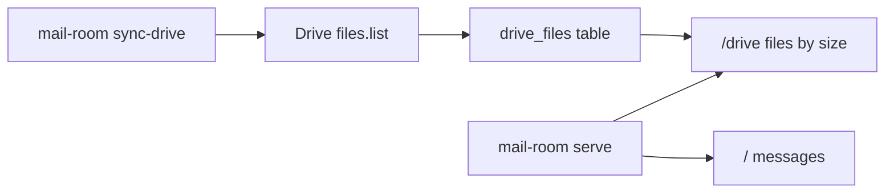

# Drive metadata sync and /drive page

Add a Drive metadata sync into the same SQLite file as a new table, plus a `/drive` page of files ranked by size. Skip folder rollups for v1.

**Yes: same SQLite file, new table.** `serve --db` already points at one database, so Gmail and Drive can share `gmail_metadata.sqlite` without changing how you launch the UI. Tables stay independent (`messages` vs `drive_files`). Folder size rollups are out of v1; Drive folders have no `size`, and recursive totals need a parent walk. We can store `parents` now so that is easy later.

Unlike Gmail, Drive `files.list` can return metadata in the list response (`fields=`), so there is no second `get`/batch round. Sync is a paginated list + upsert.

## Storage

Add to `mail_room/db.py` `init_schema`:

- `drive_files`: `file_id` PK, `name`, `mime_type`, `size` (nullable), `modified_time`, `parents` (comma-separated parent ids), `owner_email`, `web_view_link`, `trashed`, `fetched_at`
- Index on `size DESC`
- Reuse `sync_meta` with keys like `drive_last_sync_at`

Query helper: files ordered by `COALESCE(size, 0) DESC`, excluding folders (`mimeType != application/vnd.google-apps.folder`) and optionally trashed. Google Docs/Sheets often have null `size` (they do not count against Drive quota the same way); they sort to the bottom.

Default list query: **`'me' in owners and trashed = false`** so results match *your* quota, not shared files.

## Sync CLI

New `mail_room/drive_sync.py` with `run_drive_sync`, mirroring Gmail’s incremental vs `--overwrite`:

- Paginate `files.list` (`pageSize=1000`, `fields=nextPageToken, files(id,name,mimeType,size,modifiedTime,parents,owners(emailAddress),webViewLink,trashed)`)
- Incremental: skip ids already in DB (same pattern as Gmail). `--overwrite` deletes `drive_files` and re-fetches. Note: this will not refresh size of existing files unless overwrite; document that.

New subcommand in `mail_room/cli.py`: `sync-drive` with `--db`, `--credentials`, `--token`, `-v`, `--overwrite`, `--max-files`.

## OAuth

`mail_room/api.py` currently uses only `gmail.readonly`. Add `https://www.googleapis.com/auth/drive.metadata.readonly` (metadata only, no file bytes).

`load_credentials` must re-run the local-server flow when the saved token is missing the Drive scope (`not creds.has_scopes(SCOPES)`). First `sync-drive` will open a browser; Gmail sync will keep working after that. README/CLAUDE: enable **Drive API** in the same GCP project; if consent fails, delete `token.json` and re-auth.

Add `build_drive_service`.

## Web UI

- New route `/drive` in `mail_room/web.py`: load-more pagination like `messages.html` (20 then more / show all). Columns: name (link to `web_view_link`), mime type (short label), modified, size. Name search filter. No delete/keep actions (Drive changes stay out of scope, same as Gmail).
- New template `drive.html` extending `base.html`.
- Add a Drive link in existing nav on messages/senders (and back-link from `/drive`).

## Docs

Update `README.md` and `CLAUDE.md`: enable Drive API, `uv run mail-room sync-drive --db gmail_metadata.sqlite`, open `/drive`. Note that Google-native docs often show no size.

## Implementation todos

- Add `drive_files` schema + queries
- OAuth: `drive.metadata.readonly` scope, re-consent when token is missing it, `build_drive_service` (done)
- Implement `drive_sync.py` and `sync-drive` CLI subcommand
- Add `/drive` page, template, and nav links
- Update README and CLAUDE.md for Drive API setup and `sync-drive` (OAuth setup notes started in README)
